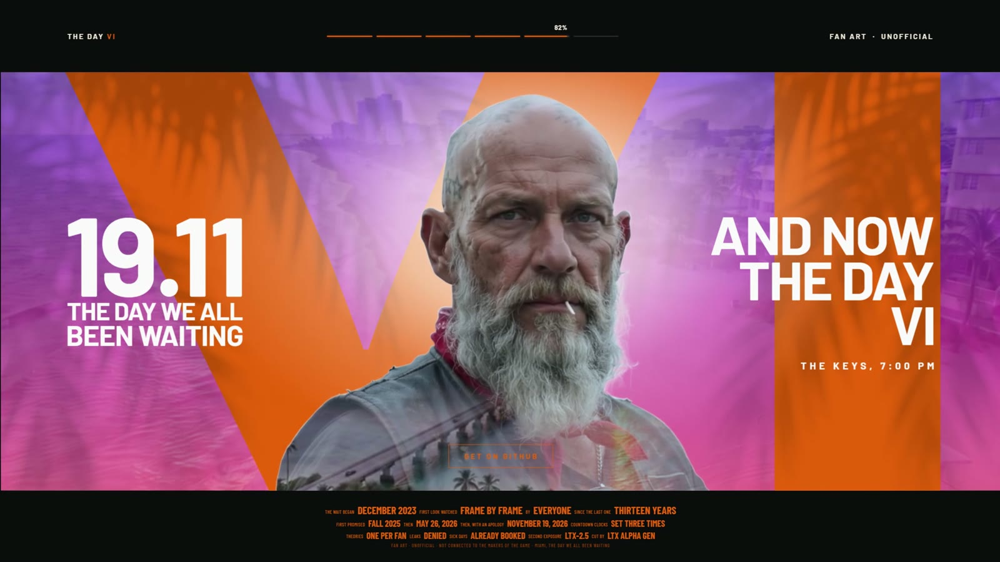
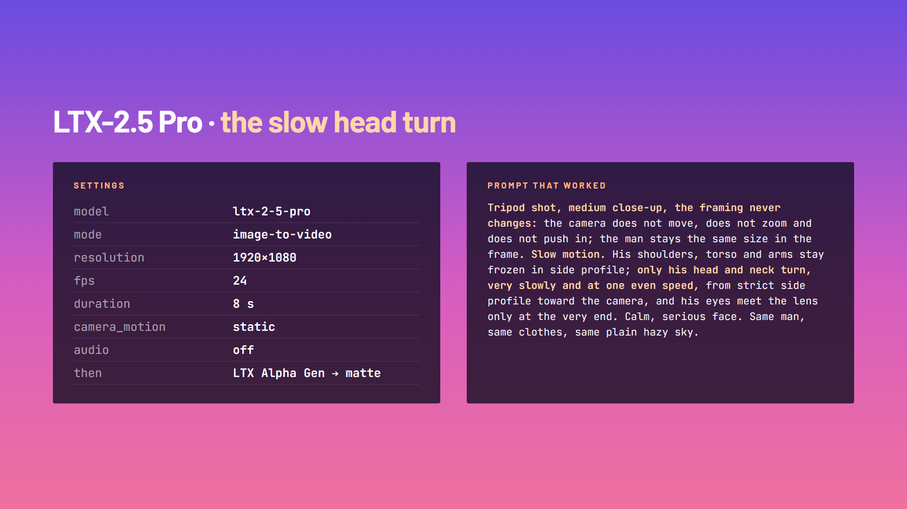

# The Day VI

A scroll-driven title sequence for the GTA VI launch, made with **LTX-2.5** and **LTX Alpha Gen**.
Six people across Florida turn to the camera, one scroll at a time, with their hour of the day running through them as a
double exposure. Police lights cut between them. The last scroll opens into a sunset and lands on the date.

**Live:** https://the-v-amirmushich.vercel.app  ·  Unofficial fan art, not connected to the makers of the game.



## How it works

```
portrait (still, side profile)  ──LTX-2.5 image-to-video──▶  slow head turn  ──LTX Alpha Gen──▶  matte
aerial still (the person's hour) ──LTX-2.5 image-to-video──▶  flyover
                                                       tools/pack.py ──▶  media/  (desktop) + media/m/ (phones)
index.html: WebGL double exposure  ·  scroll scrubs the turn  ·  police-light cut  ·  sunset finale
```

Everything on the page is one HTML file (`index.html`, no framework, no build step).

| Step | Tool | Settings that matter |
|---|---|---|
| Head turn | LTX-2.5 Pro, image-to-video | 1920×1080, 24 fps, 8 s, `camera_motion: static`. Prompt locks the framing ("tripod, the framing never changes, does not zoom") and asks for a slow, even turn of the head only. |
| Flyover | LTX-2.5 Pro, image-to-video | 1920×1080, 24 fps, 8 s, a slow forward drone push. One per hour: 5:10 am Everglades → 11:30 pm downtown Miami. |
| Cut-out | LTX Alpha Gen | the turn video in, a clean matte out (hair included). No green screen. |
| Packing | `tools/pack.py` | person + matte stacked in one video (one seek moves both), trimmed to the turn, a keyframe every 8 frames. |

All twelve LTX jobs, with their exact prompts, are in [`prompts/ltx-jobs.json`](prompts/ltx-jobs.json).
Start frames are in [`sources/`](sources/).

**Cost** (LTX pricing, Nov 2026): per person one 8 s turn ($1.36) + one 8 s flyover ($1.36) + Alpha Gen on the
turn ($0.80) ≈ **$3.50**, so about **$21** for all six.

## Run it

```bash
node tools/serve.mjs .            # http://localhost:5173  (a server with HTTP Range, so the videos seek)
```

Make your own footage:

```bash
cp .env.example .env              # put your LTX API key in it
python tools/ltx.py video prompts/ltx-jobs.json turn-baker --budget 25
python tools/ltx.py alpha footage/turn-baker --budget 25
python tools/ltx.py video prompts/ltx-jobs.json fly-baker --budget 25
python tools/pack.py turn footage/turn-baker/source.mp4 footage/turn-baker/matte.mp4 baker --to 68   # baker 68, pump 74, suit 74, barista 88, nurse 84, builder 74
python tools/pack.py city footage/fly-baker/source.mp4 baker
```

`--to` keeps only the frames of the turn itself (LTX usually finishes the turn in the first 3 s of an 8 s shot); the
page scrubs exactly those frames, whatever their count.

## Make it yours

In `index.html`:

- `CAST`: one entry per person: `key` (file names), `neck` (where the city starts filling the body, 0–1 of the
  frame height), `dx` / `dy` (framing nudges), `fog` (haze of their hour), `place` (the line under the slogan).
- `SLOGANS`: the three-line story on the right, one per scene.
- `PALETTES`: colour layouts; `7` is the one live. `?pal=1..9` previews the others, `?hero=4&frame=60` freezes a scene.

Or hand the whole thing to Claude Code with [`PROMPT.md`](PROMPT.md).



## Weight and phones

| | desktop | phone |
|---|---|---|
| all footage | 11.6 MB | 5.9 MB |
| before the first scene starts | 2.6 MB | 1.3 MB |

- A preloader shows real download progress; only the first scene gates the start, the other five load behind it.
- Turns keep a keyframe every 8 frames: smooth scrubbing at a third of the weight of an all-keyframe file.
- A phone held upright gets its own tall layout (type above, person below, type set larger) and the lighter `media/m/` set.

## Files

```
index.html            the whole site
media/  media/m/      packed footage, desktop and phone
sources/              start frames for the LTX jobs
prompts/ltx-jobs.json the LTX jobs: model, settings, prompts
tools/ltx.py          LTX API: image-to-video and Alpha Gen, with a spend ledger
tools/pack.py         footage packing for the page
tools/serve.mjs       local server with HTTP Range
PROMPT.md             one prompt to rebuild this for your own story with Claude Code
```

## License

Code: MIT. Footage and images: made for this project, free to study and remix for non-commercial use with credit.
Grand Theft Auto and GTA are trademarks of Take-Two Interactive. This is an unofficial fan project.
